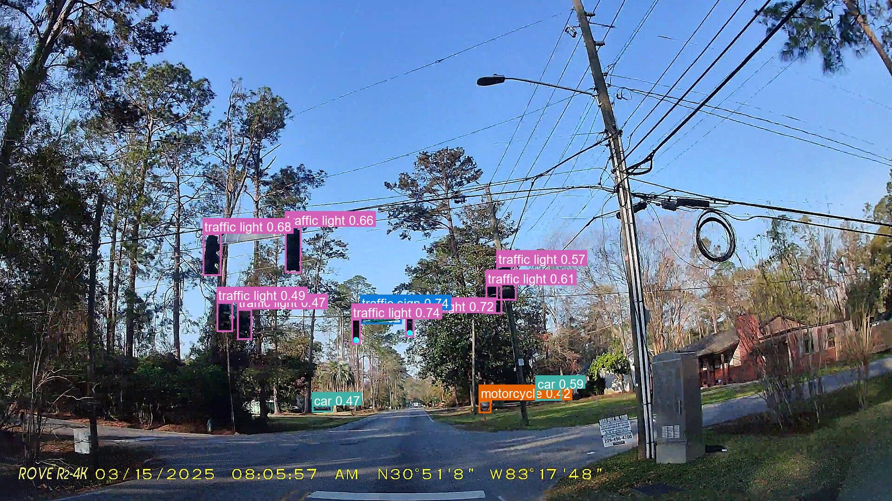
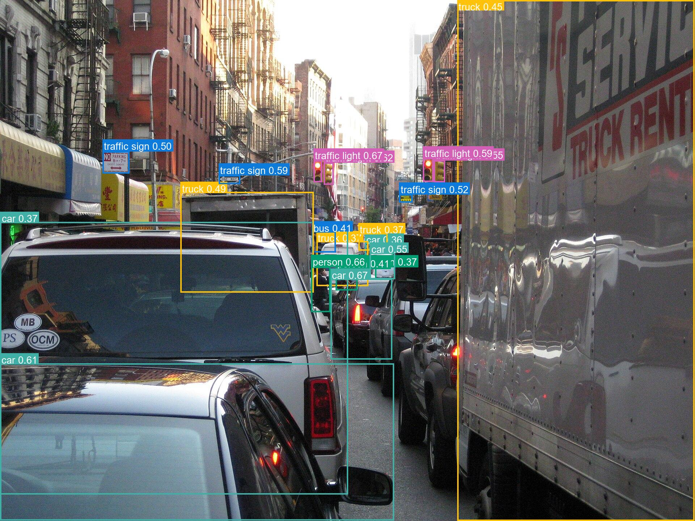
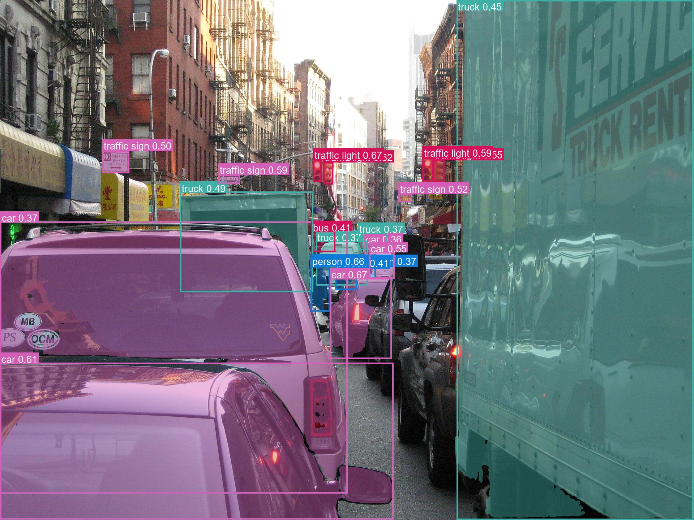

# traffic-data-engine

[](https://github.com/stillsereneflow/traffic-data-engine/actions/workflows/ci.yml)
[](LICENSE)

An auto-labeling and scene-understanding pipeline for driving data, designed
to run on a single consumer GPU (6 GB VRAM). Raw driving images go in;
reviewable pseudo-labels, traffic-domain scene tags and label-quality
metrics come out.

[中文简介](#中文简介)

## Pipeline

```
images ──> detect ──> segment ──> tag ──────> Frame JSON ──> eval (vs GT)
           (Grounding  (SAM,      (Qwen2.5-VL             └─> mine (CLIP
            DINO,       boxes ->   + taxonomy                  embedding
            open-vocab) masks)     prompts)                    search)
```

| Stage | Backbone | Status |
| --- | --- | --- |
| Core data model, from-scratch mAP, taxonomy & prompts | numpy only | ✅ M1 |
| `detect` — open-vocabulary detection | Grounding DINO (tiny) | ✅ M2 |
| `segment` — box-prompted masks | SAM (ViT-B) | ✅ M3 |
| `tag` — scene/intent/violation tagging | Qwen2.5-VL 3B (4-bit) | 🚧 M4 |
| `mine` — long-tail retrieval | CLIP ViT-B/32 | 🚧 M5 |

Architecture and milestones: [docs/DESIGN.md](docs/DESIGN.md).

## Detection demo

Open-vocabulary pseudo-labels on real street scenes (RTX 3060 Laptop, 6 GB),
produced by:

```bash
python scripts/fetch_samples.py   # CC-licensed sample images, see docs/DATA.md
tde detect --images data/samples --out out/frames.json --render out/vis
```





Adding pixel-accurate SAM masks (stored as RLE inside the same Frame JSON):

```bash
tde segment --frames out/frames.json --out out/frames_seg.json --render out/vis_seg
```



Image sources and licenses: [docs/DATA.md](docs/DATA.md).

## What makes it different

**A reviewed traffic-domain taxonomy, not an ad-hoc prompt.** The scene tag
set ([configs/taxonomy.yaml](configs/taxonomy.yaml)) is written with traffic
engineering practice in mind — road functional classes, intersection control
types, vulnerable-road-user interactions and violation categories — and every
tag carries the visual evidence a VLM must see before selecting it:

```yaml
- name: pedestrian_about_to_cross
  zh: 行人欲穿越
  hint: pedestrian at the curb facing traffic, waiting or stepping off
```

VLM responses must be strict JSON and are validated against the taxonomy;
invalid tags are rejected *and reported*, so auto-labels stay auditable.

**Transparent metrics.** Average precision is implemented from scratch in
plain numpy (greedy matching, 101-point interpolation) and unit-tested
against hand-computed precision-recall cases — pseudo-label quality numbers
you can step through in a debugger.

## Quick start

```bash
pip install -e .[dev]
pytest -q          # 37 tests, no GPU or model downloads required
ruff check .
```

GPU pipeline stages install with `pip install -e .[models]` (PyTorch,
transformers) and download their checkpoints on first use.

## Project layout

```
configs/            taxonomy.yaml — the reviewed tag set
src/traffic_data_engine/
  schema.py         Frame/Detection JSON data model
  boxes.py, rle.py  numpy box ops and COCO-style RLE masks
  evaluate.py       from-scratch AP / mAP
  taxonomy.py       taxonomy loading + validation
  prompts.py        VLM prompt builder + response validation
tests/              unit tests for everything above
```

## 中文简介

面向自动驾驶数据闭环的自动标注与场景理解流水线，为单张消费级显卡（6GB 显存）设计。流水线分五级：开放词汇检测（Grounding DINO）→ 框转掩码（SAM）→ 场景/意图/违规标签（Qwen2.5-VL + 交通领域标签体系）→ 伪标签质量评测（纯 numpy 手写 mAP，手算用例验证）→ 长尾场景挖掘（CLIP 检索）。

本仓库的差异化在于**标签体系是一份经过交通工程视角审校的工件**（`configs/taxonomy.yaml`，双语）：场景类型对应道路功能分类、交通控制对应交叉口控制方式、弱势交通参与者与风险行为对应安全分析中的交互/违法分类，每个标签都定义了 VLM 必须看到的视觉证据；模型输出经严格校验，非法标签会被拒绝并记录，保证自动标注可审计。

## License

[MIT](LICENSE)
